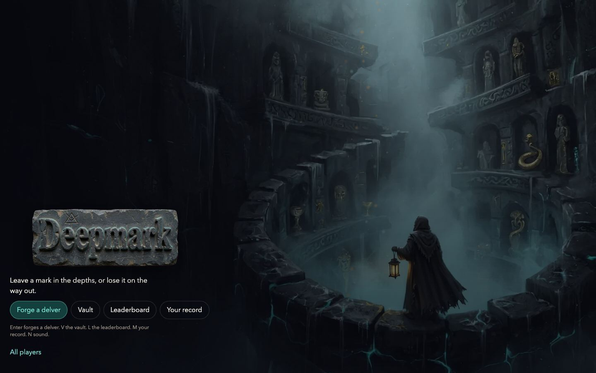
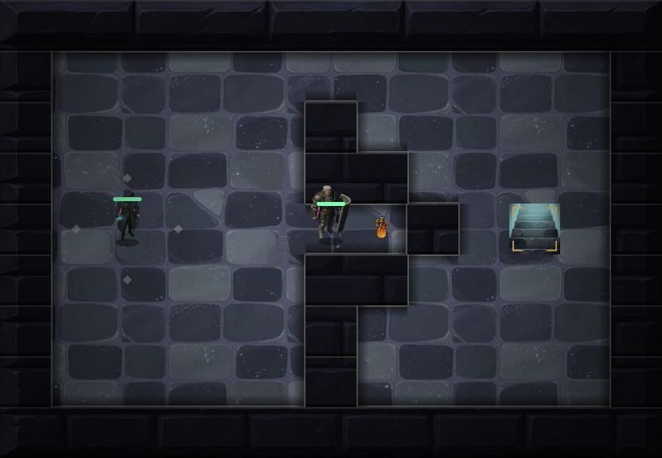

# Deepmark

A turn-based dungeon crawler where the Stellar contract replays every run, so a result or a relic cannot be claimed without playing for it.



Built for the Find Your Way Meridian Hackathon. It runs on Stellar testnet. No wallet, extension or sign-up is needed: the game creates a testnet account in your browser on the first run.

## Play in one minute

The repository is private until the submission freeze, so the live link is added here when it goes public. Until then:

```bash
cd client
bun install
bun run dev        # open the address it prints
```

[Bun](https://bun.com) 1.3.14 or newer is the only requirement.

1. Press **Enter** on the title, or choose **Forge a delver**. Pick a name, a delver, a weapon and a charm, then **Begin descent**.
2. Move with the **arrow keys** or **WASD**. Walk onto a relic to take it. Gold corners mark the stairs.
3. Walk into a guard to fight. **Enter** attacks and **Esc** retreats.
4. When a floor is clear, **Enter** descends and **Esc** extracts. Extracting banks what you hold. Dying loses it.
5. Clear all three floors and extract, and the contract replays your run and gives you that delver as a token you own. It can go down again as a veteran.

Other keys: **L** leaderboard, **V** vault, **M** your record, **N** sound. On a phone, on-screen controls take over.



If Stellar cannot be reached, the game still plays as a practice run. The floor label says Practice, and that result is not recorded.

## Why Stellar

- **Verified results.** A run is two transactions: `start_run`, where the contract issues the seed, and `finish_run`, where it replays your action log and derives the floor, score and relics itself. A forged log fails or produces a legitimate run.
- **Scarce relics.** `DMCOMMON`, `DMRARE` and `DMCORE` are Stellar assets wrapped by Stellar Asset Contracts that the game contract administers. Nothing is for sale, and no relic is minted without a verified extraction. The caveat for the current testnet issuer is under Limitations.
- **A ladder anyone can audit.** `verify_run` replays any run with no wallet and no write, from the seed in the `run_started` event and the log.

The game is built so it is fun with the chain switched off in your head. Rendering, animation and sound never wait on a transaction, and the two calls happen while the descent plays and after the result is already on screen. The boundary and its reasons are in `docs/architecture/onchain-boundary.md`.

## On testnet

| Item | Id |
|---|---|
| Game contract | `CDL7OO7MGCNMHZBF5QPJCMBLLY3ORR44TJ54ON44M25YUX6UZ7L46UZW` |
| `DMCOMMON` contract | `CCLLVBSEXPARVM6MP5HAXOSM3FGTUR3NHZSSRFRPNJSO4KWAPTMDZS7B` |
| `DMRARE` contract | `CCMDNYSZMHBDV3XBSGSQ5QVSNCVYMAGGPF6SAK3QDARIBT246FFYOIBT` |
| `DMCORE` contract | `CDIYYZSMMSDXTTA5OA2C2QUJGMJRX4UP2UBR3QCUV44GJZTJBIS4BPDR` |
| Relic issuer | `GAH27KP7NDO7HSYGIUFT7O5ONGW7M6RKCXRXIHCTLWKBM2PNU6336YMP` |

Look any of them up on [stellar.expert](https://stellar.expert/explorer/testnet). The same ids are in `client/src/stellar/config.ts`. `/stats` in the running client is a public page that lists every address with a finished run, read from the contract.

## Limitations

- **Testnet only.** There is no mainnet deployment.
- **The testnet relic issuer is not locked.** The contract is the admin of the three relic contracts, but the issuer key can still issue the assets by an ordinary payment. The deploy script locks it with `--lock` for a release deployment, and that has not been run. Details in `docs/threat-model.md`.
- **Delvers are not standard NFTs.** They have an owner and transfer interface shaped like the Stellar standard and differ from it in several calls and events. No wallet or explorer support is claimed. See `docs/architecture/nft-standard.md`.
- **Seed rerolling is limited, not removed.** A cooldown and a visible abandoned run counter make it cost time. A solver can also play a legal perfect run.
- **The key lives in the browser.** Clearing site data loses the account and its records. A passkey account is the planned replacement.
- **No third party audit.** The review that exists is described in `docs/threat-model.md`.
- **The board is not exposed to screen readers.** See `docs/accessibility.md`.

## Check it yourself

```bash
cd contracts/deepmark-contract
cargo test                 # 63 tests plus 600 vectors played by the real client
stellar contract build

cd ../../client
bun run typecheck
bun run build              # typechecks, then writes client/dist
bun run golden             # regenerates the vectors the Rust replay is tested against
bun run perf               # performance budgets, needs a running preview and Chrome
bun run a11y               # accessibility checks, same requirements
bun run contrast           # contrast ratios from the stylesheet
```

GitHub Actions runs the client checks when `client/` changes, the contract checks when `contracts/` changes, and the performance and accessibility checks in a pinned Chrome.

## Where things are

| Path | What |
|---|---|
| `client/` | The game: TypeScript, Vite, canvas. `src/game` is the simulation, `src/render` the screens, `src/stellar` the chain code |
| `contracts/deepmark-contract/` | The Soroban contract. `src/{rng,world,sim}.rs` is a bit exact port of `client/src/game/` |
| `docs/architecture/onchain-boundary.md` | What is on chain, what is not, and why |
| `docs/architecture/nft-standard.md` | Delvers compared with the Stellar NFT standard |
| `docs/threat-model.md` | The attacks considered, what stops each, what remains |
| `docs/performance.md`, `docs/accessibility.md` | Budgets and accessibility, with how they are measured |
| `docs/submission-checklist.md` | What is done and what is still open |

The contract API, the action encoding and the trust model are in `contracts/deepmark-contract/README.md`.
