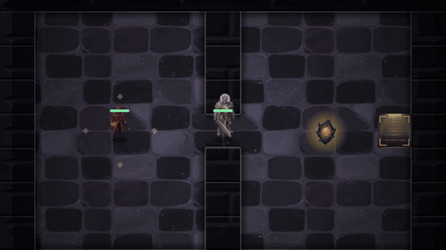
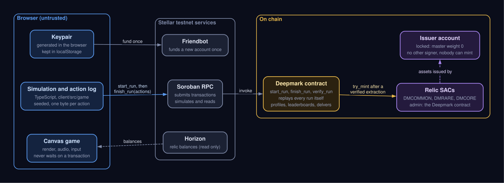
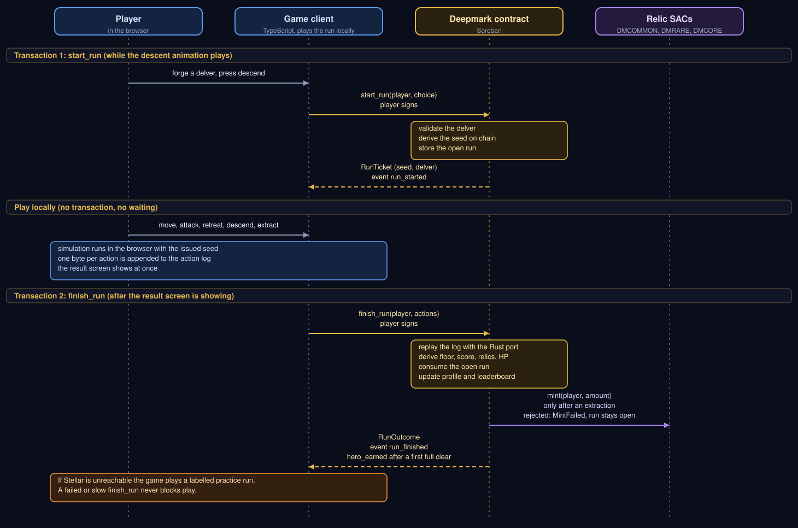

# Deepmark

A turn-based dungeon crawler where the Stellar contract replays every run, so a result or a relic cannot be claimed without playing for it.

**Play now: https://deepmark-dun.vercel.app** (Stellar testnet, no wallet or sign-up)

- A run is two transactions, and the contract replays your moves itself instead of believing a score.
- Relics are real Stellar assets that only a verified extraction can mint, from an issuer account that is locked.
- Anyone can re-check any run with one read only command, see [Verify a run in 60 seconds](#verify-a-run-in-60-seconds).


Built for the Find Your Way Meridian Hackathon. The game creates a testnet account in your browser on the first run. No wallet or extension is needed.

## Watch

| | | |
|:---:|:---:|:---:|
| [](https://youtu.be/X5GZSp7EFE8) | [](https://youtu.be/F-gPDj1Yt5A) | [](https://youtu.be/uJX_Ii3xAXE) |
| [**Trailer, 30 s**](https://youtu.be/X5GZSp7EFE8)<br>The game in motion, recorded from the production build. | [**Trailer, 90 s**](https://youtu.be/F-gPDj1Yt5A)<br>Adds what the contract verifies and why a result cannot be forged. | [**Share card**](https://youtu.be/uJX_Ii3xAXE)<br>The animated card a player shares after a verified run. |

## Play in one minute

To run it locally instead of the live link:

```bash
cd client
bun install
bun run dev        # open the address it prints
```

[Bun](https://bun.com) 1.3.14 or newer is the only requirement.

1. Press **Enter** on the title, or choose **Forge a delver**. Pick a name, a delver, a weapon and a charm, then **Begin descent**.
2. Move with the **arrow keys** or **WASD**. Walk onto a relic to take it. Gold corners mark the stairs.
3. Walk into a guard to fight. **Enter** attacks and **Esc** retreats.
4. When a floor is clear, **Enter** descends and **Esc** extracts. Extracting banks what you hold. Dying loses it.
5. Clear all three floors and extract, and the contract replays your run and gives you that delver as a token you own. It can go down again as a veteran.

Other keys: **L** leaderboard, **V** vault, **M** your record, **N** sound. On a phone, on-screen controls take over.




If Stellar cannot be reached, the game still plays as a practice run. The floor label says Practice, and that result is not recorded.

## Why Stellar

- **Verified results.** A run is two transactions: `start_run`, where the contract issues the seed, and `finish_run`, where it replays your action log and derives the floor, score and relics itself. A forged log fails or produces a legitimate run.
- **Relics from a locked issuer.** `DMCOMMON`, `DMRARE` and `DMCORE` are classic Stellar assets wrapped by Stellar Asset Contracts that the game contract administers. The issuer account has a single signer with weight 0, so only a verified extraction can mint. Nothing is for sale. The limits of that claim are under Limitations.
- **A ladder anyone can audit.** `verify_run` replays any run with no wallet and no write, from the seed in the `run_started` event and the log.
- **Why this chain and not a database.** Ledgers close about every five seconds (the setup transactions in `docs/deployments.md` are five seconds apart), a whole run replays inside one Soroban transaction, and classic trustlines, Friendbot and Stellar Asset Contracts give a new player an account and a real asset with no wallet in sight. A database could also store a score. It could not let a stranger check that the operator did not edit it.

The game is built so it is fun with the chain switched off in your head. Rendering, animation and sound never wait on a transaction, and the two calls happen while the descent plays and after the result is already on screen. The boundary and its reasons are in [`docs/architecture/onchain-boundary.md`](docs/architecture/onchain-boundary.md).





## Verify a run in 60 seconds

You need the [Stellar CLI](https://developers.stellar.org/docs/tools/cli/install-cli) and nothing else. No account of yours is used and nothing is sent: `--send no` simulates the call, and the source account is the public admin address, which only has to exist.

The run below is a full clear on the live testnet contract. Its seed comes from the `run_started` event of the [`start_run` transaction](https://stellar.expert/explorer/testnet/tx/5fdccef0e229953a20cd832e6dce9d5732065ee604b3a3c1b9cec3ec791ca090) (`seed` 1090415896, base 0, weapon 1, charm 0, rank 0), and its action log is the argument of the [`finish_run` transaction](https://stellar.expert/explorer/testnet/tx/349e4df814b2a0f3b6a530d05855a5d70f935a321fac37067de62a6de12e7524).

```bash
# 1. Read the action log out of the finish_run transaction (optional, it is also printed below)
curl -s https://horizon-testnet.stellar.org/transactions/349e4df814b2a0f3b6a530d05855a5d70f935a321fac37067de62a6de12e7524 \
  | jq -r .envelope_xdr \
  | stellar xdr decode --type TransactionEnvelope --input single-base64 --output json \
  | jq -r '.tx.tx.operations[0].body.invoke_host_function.host_function.invoke_contract.args[1].bytes'

# 2. Ask the contract to replay it
stellar contract invoke \
  --id CDQDI2SNKQHPC7YW7YCW7USYLHXW2XTV5JBXWC24K53KDMY43DBHH7RX \
  --network testnet \
  --source-account GCJWADMYI4N42EDLCRAYGORAHPXLRSIZVQSN75H552H2GWKF3SXL2WEX \
  --send no \
  -- verify_run \
  --base 0 --weapon 1 --charm 0 --rank 0 --seed 1090415896 \
  --actions 030303030405030403030202000000030301030103010306030300010300000100000304040101010304040303020200000003030103010301030603030303050305030404030303030303
```

Expected output:

```json
{"actions":75,"extracted":true,"floor_reached":3,"hero_id":null,"hp_left":3,"rank_key":288084998468608,"relics_common":1,"relics_core":1,"relics_rare":1,"score":6}
```

Compare it with the `run_finished` event on the `finish_run` transaction, where the contract derived the same floor (3), HP left (3), score (6), actions (75) and relics (one of each). That transaction also carries the `hero_earned` event for the first full clear (delver 1) and three `mint` events from the relic contracts. `hero_id` is `null` in the read only replay because `verify_run` never mints. Change one byte of the log, or the seed, and the call fails or returns a different result. Both commands were run on 2026-10-12 against the deployment below.

To check that nobody else can mint relics:

```bash
curl -s https://horizon-testnet.stellar.org/accounts/GAEZFWDURKH2UF5DF5S26AXHLTUE4NNQ4YDDROFRXNTDO46THSXJFA7Q | jq '{signers, thresholds}'
stellar contract invoke --id CDK5SL4OP6CAFZPFJ2YOTSBN3NDHCJ4A23UA4TXIZP5DFO7RT6IH4S5R --network testnet \
  --source-account GCJWADMYI4N42EDLCRAYGORAHPXLRSIZVQSN75H552H2GWKF3SXL2WEX --send no -- admin
```

The first shows one signer with weight 0 and all thresholds 0 (the [lock transaction](https://stellar.expert/explorer/testnet/tx/ddae4f0c5f28ff1bc08af97949dd85861fe3b087eefb67b1e4893b354c514e28)). The second prints the game contract as the admin of `DMCOMMON`.

## On testnet

Redeployed on 2026-10-12. The earlier deployments are retired and listed in [`docs/deployments.md`](docs/deployments.md).

| Item | Id |
|---|---|
| Game contract | [`CDQDI2SNKQHPC7YW7YCW7USYLHXW2XTV5JBXWC24K53KDMY43DBHH7RX`](https://stellar.expert/explorer/testnet/contract/CDQDI2SNKQHPC7YW7YCW7USYLHXW2XTV5JBXWC24K53KDMY43DBHH7RX) |
| `DMCOMMON` contract | [`CDK5SL4OP6CAFZPFJ2YOTSBN3NDHCJ4A23UA4TXIZP5DFO7RT6IH4S5R`](https://stellar.expert/explorer/testnet/contract/CDK5SL4OP6CAFZPFJ2YOTSBN3NDHCJ4A23UA4TXIZP5DFO7RT6IH4S5R) |
| `DMRARE` contract | [`CCQFEYZR3D4XHTMLV3XJZBTZUT4WXZS2LUXHPFTH7DRRZENZNU2NVZ5L`](https://stellar.expert/explorer/testnet/contract/CCQFEYZR3D4XHTMLV3XJZBTZUT4WXZS2LUXHPFTH7DRRZENZNU2NVZ5L) |
| `DMCORE` contract | [`CAHKK75BOXGBKSXBB3EFPWS6C3IZIXIFLYI3A74GYCRSI4U6NKVZTLIM`](https://stellar.expert/explorer/testnet/contract/CAHKK75BOXGBKSXBB3EFPWS6C3IZIXIFLYI3A74GYCRSI4U6NKVZTLIM) |
| Relic issuer (locked) | [`GAEZFWDURKH2UF5DF5S26AXHLTUE4NNQ4YDDROFRXNTDO46THSXJFA7Q`](https://stellar.expert/explorer/testnet/account/GAEZFWDURKH2UF5DF5S26AXHLTUE4NNQ4YDDROFRXNTDO46THSXJFA7Q) |
| Contract admin | [`GCJWADMYI4N42EDLCRAYGORAHPXLRSIZVQSN75H552H2GWKF3SXL2WEX`](https://stellar.expert/explorer/testnet/account/GCJWADMYI4N42EDLCRAYGORAHPXLRSIZVQSN75H552H2GWKF3SXL2WEX) |
| Wasm | 28,107 bytes, sha256 `db721cb97242bf5d9710d70752959a5658c2be81fee70d5fdd7253b878f80d07` |

Asset pages with supply and holders: [`DMCOMMON`](https://stellar.expert/explorer/testnet/asset/DMCOMMON-GAEZFWDURKH2UF5DF5S26AXHLTUE4NNQ4YDDROFRXNTDO46THSXJFA7Q), [`DMRARE`](https://stellar.expert/explorer/testnet/asset/DMRARE-GAEZFWDURKH2UF5DF5S26AXHLTUE4NNQ4YDDROFRXNTDO46THSXJFA7Q) and [`DMCORE`](https://stellar.expert/explorer/testnet/asset/DMCORE-GAEZFWDURKH2UF5DF5S26AXHLTUE4NNQ4YDDROFRXNTDO46THSXJFA7Q).

Proof transactions, all `successful` on testnet. Each run was played through the real client on a fresh throwaway account.

- [`Issuer lock`](https://stellar.expert/explorer/testnet/tx/ddae4f0c5f28ff1bc08af97949dd85861fe3b087eefb67b1e4893b354c514e28): master key weight set to 0.
- First `start_run` on the deployment, a new player: [`d1dc76e7...100b`](https://stellar.expert/explorer/testnet/tx/d1dc76e76d4498adec6396fccdc9cad8e0314b832c8d0f0e8908a461c76e100b).
- Early extraction on floor 1, mints `DMCOMMON`: [`aecb8b3f...db6a`](https://stellar.expert/explorer/testnet/tx/aecb8b3fa89b0340ce84b6695ea2570d3e327de010e79f460447e63c6d53db6a).
- Extraction on floor 2, mints `DMCOMMON` and `DMRARE`: [`51d74c53...e7cc`](https://stellar.expert/explorer/testnet/tx/51d74c53126f42064f0208346da18ee941289bc1009ae72e8b9b8fd70380e7cc).
- Death on floor 2, recorded with no relics: [`bd264709...4841`](https://stellar.expert/explorer/testnet/tx/bd2647098500dc954db3a4c989471ba703110343343798982587b91566c54841).
- Full clear, mints all three relics and earns delver 1 (`hero_earned`): [`349e4df8...7524`](https://stellar.expert/explorer/testnet/tx/349e4df814b2a0f3b6a530d05855a5d70f935a321fac37067de62a6de12e7524), started by [`5fdccef0...a090`](https://stellar.expert/explorer/testnet/tx/5fdccef0e229953a20cd832e6dce9d5732065ee604b3a3c1b9cec3ec791ca090).
- Veteran run with that delver, mints `DMCORE`: [`5b74020c...9c3f`](https://stellar.expert/explorer/testnet/tx/5b74020c03ac5dc0e43d4092ee2dd3338eaf220dafc76f67ce521bab53609c3f), started by [`9ca436ee...a9cc`](https://stellar.expert/explorer/testnet/tx/9ca436ee1f760f5d5d8a1cb8b8c12263dfca98423af55f78a1660fd77aa3a9cc).
- A second full clear, which earns delver 0: [`7881adab...9334`](https://stellar.expert/explorer/testnet/tx/7881adabe0dd17c9319a9b975d8c7e76796bb112214df5dac114d31805159334), started by [`7abbf360...1f09`](https://stellar.expert/explorer/testnet/tx/7abbf360511ef3d548b167a69507c9cd57272e5ff93256277da12fd1df441f09).
- Deploy the game contract: [`dd0f5f24...1313`](https://stellar.expert/explorer/testnet/tx/dd0f5f24645ebe85f14e63ec05a38b51e0979f29032dd14980990dd0d5d61313) and upload its wasm: [`593d2ea0...369f`](https://stellar.expert/explorer/testnet/tx/593d2ea0e7a185d29bb8f498755c33acb69138aee50aab8208a016e51ac6369f).

Every setup transaction is in [`docs/deployments.md`](docs/deployments.md). The same ids are in `client/src/stellar/config.ts`. `/stats` in the running client is a public page that lists every address with a finished run, read from the contract.

The playtest behind these transactions created throwaway accounts, each with its three relic trustlines, so the holder counts Horizon reports for the relics count test accounts, not players. After the six runs the authorized supply was 4 `DMCOMMON`, 3 `DMRARE` and 3 `DMCORE`, exactly the sum of the mints in the `run_finished` events.

## Measured costs

Read from the transactions of the current deployment through Horizon (`fee_charged`) and the Soroban `rentFeeCharged` in each transaction's result meta. One XLM is 10,000,000 stroops. All on testnet, none on mainnet, so these say nothing about mainnet fees.

| Call | Transaction | Fee charged (stroops) | Of which rent | XLM |
|---|---|---|---|---|
| `start_run`, first call on the contract (new player) | [`d1dc76e7...100b`](https://stellar.expert/explorer/testnet/tx/d1dc76e76d4498adec6396fccdc9cad8e0314b832c8d0f0e8908a461c76e100b) | 8,970,532 | 8,947,995 | 0.897 |
| `start_run`, another new player | [`a6ebcd48...91e8`](https://stellar.expert/explorer/testnet/tx/a6ebcd48129c055face7b92f484343f098e673c59083ed06245669203f6d91e8) | 7,910,423 | 7,887,853 | 0.791 |
| `start_run`, returning player with a veteran | [`9ca436ee...a9cc`](https://stellar.expert/explorer/testnet/tx/9ca436ee1f760f5d5d8a1cb8b8c12263dfca98423af55f78a1660fd77aa3a9cc) | 55,755 | 39,321 | 0.0056 |
| `finish_run`, death | [`bd264709...4841`](https://stellar.expert/explorer/testnet/tx/bd2647098500dc954db3a4c989471ba703110343343798982587b91566c54841) | 2,794,495 | 2,776,162 | 0.279 |
| `finish_run`, extraction with 1 relic | [`aecb8b3f...db6a`](https://stellar.expert/explorer/testnet/tx/aecb8b3fa89b0340ce84b6695ea2570d3e327de010e79f460447e63c6d53db6a) | 3,860,064 | 3,836,344 | 0.386 |
| `finish_run`, extraction with 2 relics | [`51d74c53...e7cc`](https://stellar.expert/explorer/testnet/tx/51d74c53126f42064f0208346da18ee941289bc1009ae72e8b9b8fd70380e7cc) | 2,806,358 | 2,776,171 | 0.281 |
| `finish_run`, full clear, 3 relics, delver earned | [`349e4df8...7524`](https://stellar.expert/explorer/testnet/tx/349e4df814b2a0f3b6a530d05855a5d70f935a321fac37067de62a6de12e7524) | 9,982,709 | 9,934,956 | 0.998 |
| `finish_run`, veteran, 1 relic | [`5b74020c...9c3f`](https://stellar.expert/explorer/testnet/tx/5b74020c03ac5dc0e43d4092ee2dd3338eaf220dafc76f67ce521bab53609c3f) | 3,913,761 | 3,886,278 | 0.391 |

What the table shows. More than 99% of the start fee is rent, and most of it is one time: a new player pays about 0.79 XLM once for their persistent record, then about 0.006 XLM per later start. A complete fresh run (new player, full clear, delver minted) costs about 1.8 to 1.9 XLM and a death about 1.07 XLM, dominated by one time storage for the player record, the delver and the three relic balances. The first `start_run` on this deployment cost 0.897 XLM, about 0.105 XLM above a normal new player start. The earlier deployment charged 183.9 XLM for its first call. This deployment extended the lifetime of the contract instance and its wasm right after deploying ([instance](https://stellar.expert/explorer/testnet/tx/3a174eec310202b9124525f8099e6228a8042c310ce08838b7a2b47a0609d4ba) and [wasm](https://stellar.expert/explorer/testnet/tx/ae8a038a8470479fc2fa603dee70d718b7f75838bed101d13a09739661c389fb)), which is the change that fits the drop, since the first call no longer has to pay that rent. No `run_started` event existed before run 1 (checked with Soroban RPC `getEvents` over the preceding 100,000 ledgers), so run 1 was the first call. The compute side is small: the worst case in the test suite (2,000 inputs) uses about 3.6 million instructions against a 400 million limit.

## Limitations

- **Testnet only.** There is no mainnet deployment.
- **The contract has an admin who can upgrade it.** Replay verification protects players from forged logs, not from the admin while the role exists. The role is meant to be renounced or moved to a multisig before any mainnet release, and there is no timelock on `upgrade`. Details in [`docs/threat-model.md`](docs/threat-model.md).
- **Relics are not capped.** The issuer is locked and only a verified run mints, but nothing limits how many verified runs one person makes. A bot can solve a seed offline and use many free testnet accounts, so a relic proves a legal run was replayed, not that a distinct person played it.
- **Seed rerolling is limited, not removed.** A cooldown and a visible abandoned run counter make it cost time, but both are per address and a new address resets them. A solver can also play a legal perfect run.
- **Some idle data can still expire.** `start_run` renews the player counter, the delver counter, both leaderboards and the delver a veteran run uses. A player's own record and the player index entries are renewed only when written, so an account that does not play for about 120 days can have them archived. They can be restored, nothing is lost, but the client does not restore them yet.
- **New players register one per ledger.** A new player is appended to a sequential index (`PlayerAt(i)`), so several brand new players whose `start_run` lands in the same ledger simulate the same next index, and the later transactions fail with `storage exceeded_limit` on the key `PlayerAt N`. In the playtest, 3 fresh accounts starting together gave 2 failures out of 3. This is a throughput limit of new player registration, about one per ledger (about 5 seconds). The client detects a failed `start_run` (`client/src/stellar/txOutcome.ts`), retries up to 4 times with jittered backoff and re-simulates, and a local re-run had 6 of 6 starts succeed. A returning player is never affected. A registry keyed by address would remove the limit in a later contract version.
- **Finishing needs the relic trustlines.** If a relic mint is rejected (for example no trustline), `finish_run` fails with `MintFailed` and the run stays open, so it can be finished again once the cause is fixed. The client adds the trustlines at account setup.
- **Delvers are not standard NFTs.** They have an owner and transfer interface shaped like the Stellar standard and differ from it in several calls and events. Explorer support has not been tested and is not claimed. See [`docs/architecture/delvers-and-nft-standard.md`](docs/architecture/delvers-and-nft-standard.md).
- **The key lives in the browser.** Clearing site data loses the account and its records. A passkey account is the planned replacement.
- **No third party audit.** The review that exists is described in the threat model.
- **The board is not exposed to screen readers.** See [`docs/accessibility.md`](docs/accessibility.md).

## Check it yourself

```bash
cd contracts/deepmark-contract
cargo test                 # 80 tests plus 600 vectors played by the real client
stellar contract build

cd ../../client
bun run typecheck
bun run build              # typechecks, then writes client/dist
bun run golden             # regenerates the vectors the Rust replay is tested against
bun run perf               # performance budgets, needs a running preview and Chrome
bun run a11y               # accessibility checks, same requirements
bun run contrast           # contrast ratios from the stylesheet
```

GitHub Actions runs the client checks when `client/` changes, the contract checks when `contracts/` changes, and the performance and accessibility checks in a pinned Chrome.

## Roadmap

Next: share cards and challenge links, a decision on the contract admin role with a date, then accounts that survive clearing the browser, sponsored fees and a first season. Mainnet comes only after the admin is renounced or moved to a multisig and an independent review is done. The full plan, with what is still unverified, is in [`docs/roadmap.md`](docs/roadmap.md).

## Business model

Deepmark is a free game with no token and nothing for sale that makes a delver stronger. If it earns money, the plan is sponsored seasonal ladders, where a sponsor funds the prizes and results are paid out only for runs the contract has replayed, with optional cosmetics that never touch play. Nothing here is signed or live. The reasoning and what is not planned are in [`docs/business-model.md`](docs/business-model.md).

## Where things are

| Path | What |
|---|---|
| `client/` | The game: TypeScript, Vite, canvas. `src/game` is the simulation, `src/render` the screens, `src/stellar` the chain code |
| `contracts/deepmark-contract/` | The Soroban contract. `src/{rng,world,sim}.rs` is a bit exact port of `client/src/game/` |
| `docs/architecture/onchain-boundary.md` | What is on chain, what is not, and why |
| `docs/architecture/delvers-and-nft-standard.md` | Delvers compared with the Stellar NFT standard |
| `docs/deployments.md` | Testnet ids and the transaction of every deployment step |
| `docs/threat-model.md` | The attacks considered, what stops each, what remains |
| `docs/roadmap.md`, `docs/business-model.md` | Where the project is going and how it could be funded |
| `docs/performance.md`, `docs/accessibility.md` | Budgets and accessibility, with how they are measured |
| `docs/submission-checklist.md` | What is done and what is still open |

The contract API, the action encoding and the trust model are in [`contracts/deepmark-contract/README.md`](contracts/deepmark-contract/README.md).

## Resumen en espanol

Deepmark es un juego de mazmorras por turnos. Cuando sales de la mazmorra, el contrato de Stellar vuelve a jugar tu partida movimiento por movimiento a partir de la semilla que el mismo contrato te dio, y calcula el resultado por su cuenta. Por eso nadie puede declarar un puntaje, un lugar en el ranking o una reliquia sin haber jugado para conseguirlos.

- Juega en https://deepmark-dun.vercel.app. Corre en la red de pruebas de Stellar y no necesitas billetera ni registro: el juego crea una cuenta de prueba en tu navegador.
- Cada partida son dos transacciones, `start_run` y `finish_run`. La animacion y el sonido nunca esperan a la red, y si Stellar no responde puedes seguir en una partida de practica que no se registra.
- Las reliquias (`DMCOMMON`, `DMRARE`, `DMCORE`) son activos de Stellar. La cuenta emisora esta bloqueada y solo una extraccion verificada puede crearlas. No se venden.
- Cualquiera puede comprobar una partida con un comando de solo lectura, como se muestra en "Verify a run in 60 seconds".
- Limites honestos: solo testnet, el contrato todavia tiene una llave de administrador que puede actualizarlo, no hay tope de reliquias, los delvers no son NFT estandar y no hay auditoria externa. La lista completa esta en la seccion Limitations y en [`docs/threat-model.md`](docs/threat-model.md).

## Licence

Licensed under the [Apache License 2.0](LICENSE).
