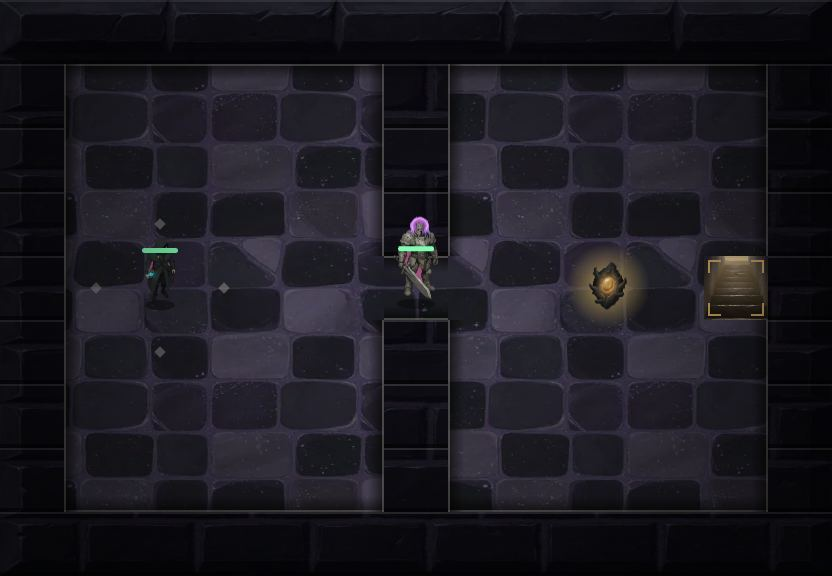
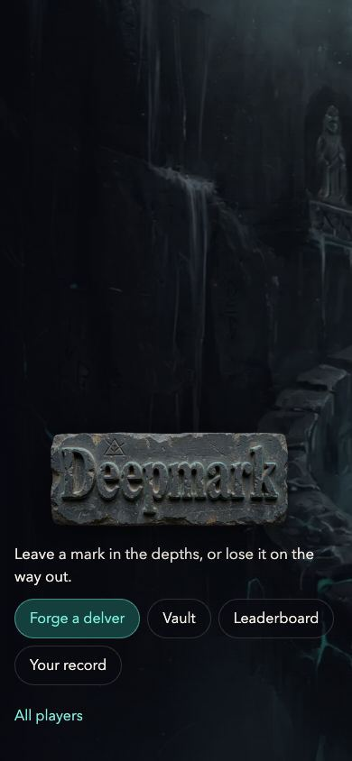

# Deepmark

A turn-based dungeon crawler on Stellar testnet. Descend three floors, decide what to keep, and leave a result the contract can replay.


Built for the Find Your Way Meridian Hackathon. The game is live on Stellar testnet. The contract replays every run from its action log, so a result cannot be claimed without playing it, and a verified extraction mints relics as Stellar assets (`DMCOMMON`, `DMRARE`, `DMCORE`). No wallet or extension is needed. See `docs/architecture/onchain-boundary.md` for what is verified on-chain and what stays on the client.

Contract (testnet): `CDL7OO7MGCNMHZBF5QPJCMBLLY3ORR44TJ54ON44M25YUX6UZ7L46UZW`

Forge a delver from predefined items, descend, and if you clear all three floors that exact delver becomes yours, as a verified token you can send down again as a veteran.


Open floor is lighter than blocked stone, and a thin gray seam separates them. Gold corners mark the stairs.



The third floor is the way out. The stairs climb toward daylight, and the core relic is the gold stone beyond the boss. If Stellar cannot open the run, the game still plays and the floor label says Practice, so it is clear that result will not be recorded.

The title also fits a phone. The menu stays on the dark side of the shaft, with targets large enough to tap.



## Run it locally

The client uses [Bun](https://bun.com) 1.3.14 or newer as its package manager.

```bash
cd client
bun install
bun run dev
```

`bun run typecheck` checks the TypeScript project. `bun run golden` regenerates the vectors that tie the TypeScript game to the contract's Rust replay. `bun run build` typechecks and writes the production bundle to `client/dist`.

WASD or arrow keys to move, Enter to confirm, attack or descend, Esc to retreat or extract. M opens your record: runs in this browser, and your verified record and relic balances on Stellar testnet. `/stats` is the public traction page: every address with a finished run, run totals and best floors, read from the testnet contract. On a narrow screen the board scales to the window and on-screen controls take over. A Stellar testnet account is created and funded automatically on first run.

## Contract

```
cd contracts/deepmark-contract
cargo test
stellar contract build
```

Deployed to testnet with three relic Stellar Asset Contracts. The contract API, the action bytes and the trust model are in `contracts/deepmark-contract/README.md`.

## Checks

GitHub Actions runs the client commands when `client/` changes, and the contract commands when `contracts/` changes. A change to either workflow file runs that workflow. The client commands are `bun run typecheck` and `bun run build`. The contract commands are `cargo test` and `stellar contract build`.
